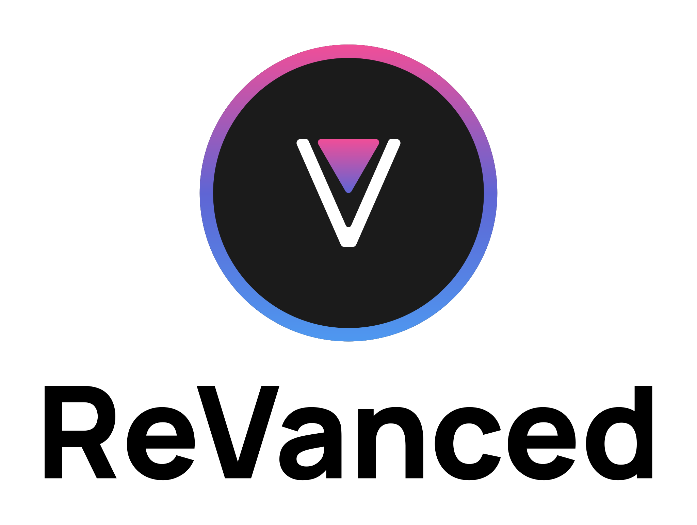
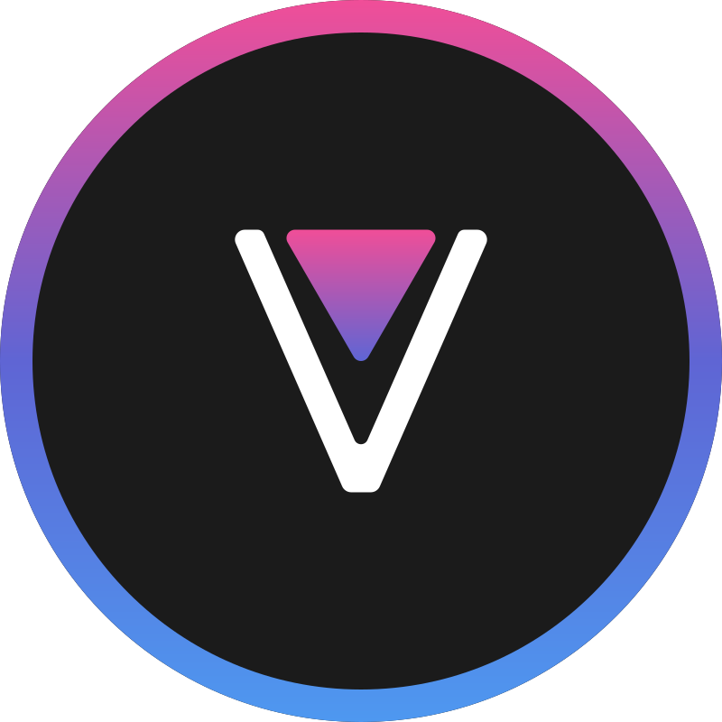

  <picture>
    <fonte
      larghezza="256px"
      media="(preferisce lo schema dei colori: scuro)"
      srcset="assets/revanced-headline/revanced-headline-vertical-dark.svg"
    >
    
  </immagine>
   
  <a href="https://revanced.app/">
       <immagine>
           <fonte altezza="24px" media="(preferisce lo schema dei colori: scuro)" srcset="assets/revanced-logo/revanced-logo.svg" />
           
       </immagine>
   </a>&nbsp;&nbsp;&nbsp;
   <a href="https://github.com/ReVanced">
       <immagine>
           <fonte altezza="24px" media="(preferisce lo schema dei colori: scuro)" srcset="https://i.ibb.co/dMMmCrW/Git-Hub-Mark.png" />
           
       </immagine>
   </a>&nbsp;&nbsp;&nbsp;
   <a href="http://revanced.app/discord">
       <immagine>
           <fonte altezza="24px" media="(preferisce lo schema dei colori: scudo)" srcset="https://user-images.githubusercontent.com/13122796/178032563-d4e084b7-244e-4358-af50-26bde6dd4996.png" />
           
       </immaginare>
   </a>&nbsp;&nbsp;&nbsp;
   <a href="https://reddit.com/r/revancedapp">
       <immaginare>
           <fonte altezza="24px" media="(preferisce lo schema dei colori: scudo)" srcset="https://user-images.githubusercontent.com/13122796/178032351-9d9d5619-8ef7-470a-9eec-2744ece54553.png" />
           
       </immaginare>
   </a>&nbsp;&nbsp;&nbsp;
   <a href="https://t.me/app_revanced">
      <immaginare>
         <fonte altezza="24px" media="(preferisce lo schema dei colori: scudo)" srcset="https://user-images.githubusercontent.com/13122796/178032213-faf25ab8-0bc3-4a94-a730-b524c96df124.png" />
         
      </immaginare>
   </a>&nbsp;&nbsp;&nbsp;
   <a href="https://x.com/revancedapp">
      <immaginare>
         <fonte media="(preferisce lo schema dei colori: scudo)" srcset="https://user-images.githubusercontent.com/93124920/270180600-7c1b38bf-889b-4d68-bd5e-b9d86f91421a.png">
         
      </immaginare>
   </a>&nbsp;&nbsp;&nbsp;
   <a href="https://www.youtube.com/@ReVanced">
      <immaginare>
         <fonte altezza="24px" media="(preferisce lo schema dei colori: scudo)" srcset="https://user-images.githubusercontent.com/13122796/178032714-c51c7492-0666-44ac-99c2-f003a695ab50.png" />
         
     </immaginare>
   </a>
    
    
   Continua l'eredità di Vanced

# 👋 Linea guida sui contributi

Questo documento descrive come contribuire a un ReVanced Manager.

## 📖 Risorso per aiutarti a iniziare

* Il [documentazione](/documentari/README.md) fornisce passaggi per creare ReVanced Manager dalla fonte
* Nostro [arretrato](https://github.com/orgs/ReVanced/projects/12) è colomba teniamo traccia di ciò su cui stiamo lavorando
* [Problemi](https://github.com/ReVanced/revanced-manager/issues) sono colomba teniamo traccia dei bug e delle ricerche di funzionalità

## 🙏 Invio di una ricchezza di funzionalità

Le funzioni possono esse ricche aprendo un problema utilizzando il
[Modello di problema della ricchezza di funzionalità](https://github.com/ReVanced/revanced-manager/issues/new?assignees=&labels=Feature+request&projects=&template=feature_request.yml&title=feat%3A+).

> **Nota**
> Il più ricco possibile accetta o rifiuta una discriminazione dei manutentori di ReVanced Manager.
> È necessario fornire una buona motivazione affinché una ricca venga accettata.

## 🐞 Invio di una firma di bug

Se riscontri un bug durante l'utilizzo di ReVanced Manager, apri un problema utilizzando
[Modello di problema di firma bug](https://github.com/ReVanced/revanced-manager/issues/new?assignees=&labels=Bug+report&projects=&template=bug_report.yml&title=bug%3A+).

## 📝 Vieni a contribuire

1. Prima di contribuire, si consigli di aprile un problema per discutere la modifica
   con i manutentori di ReVanced Manager. Questo ti aiuterà a determinare se il tuo cambiamento è accettabile
   e se vale la pena dedicare del tempo alla sua implementazione
2. Lo sviluppo ave sul `scultore` ramo. Segui il fork del repository e crea il tuo ramo da `scultore`
3. Impegna le tue modifica
4. Invia una ricca tira al `scultore` ramo del repository e problemi di riferimento
   che la tua richiesta pull si chiuda nella descrizione della tua richiesta pull
5. Il nostro team esaminerà la tua ricchezza tira e ti fornirà un feedback. Una volta approvata la tua ricca attrazione,
   verrà scorpato al `scultore` ramo e sarà incluso nella prossima versione di ReVanced Manager

## 🤚 Voglio contribuire ma non così come programmare

Anche se non sai programmare, puoi comuni contributi
traduzione di ReVanced Manager su [Crowdin](https://translate.revanced.app/).

❤️ Grazie per aver preso in considerazione l'idea di contribuire come ReVanced Manager,  
RiVantificatoHal
ah ah
